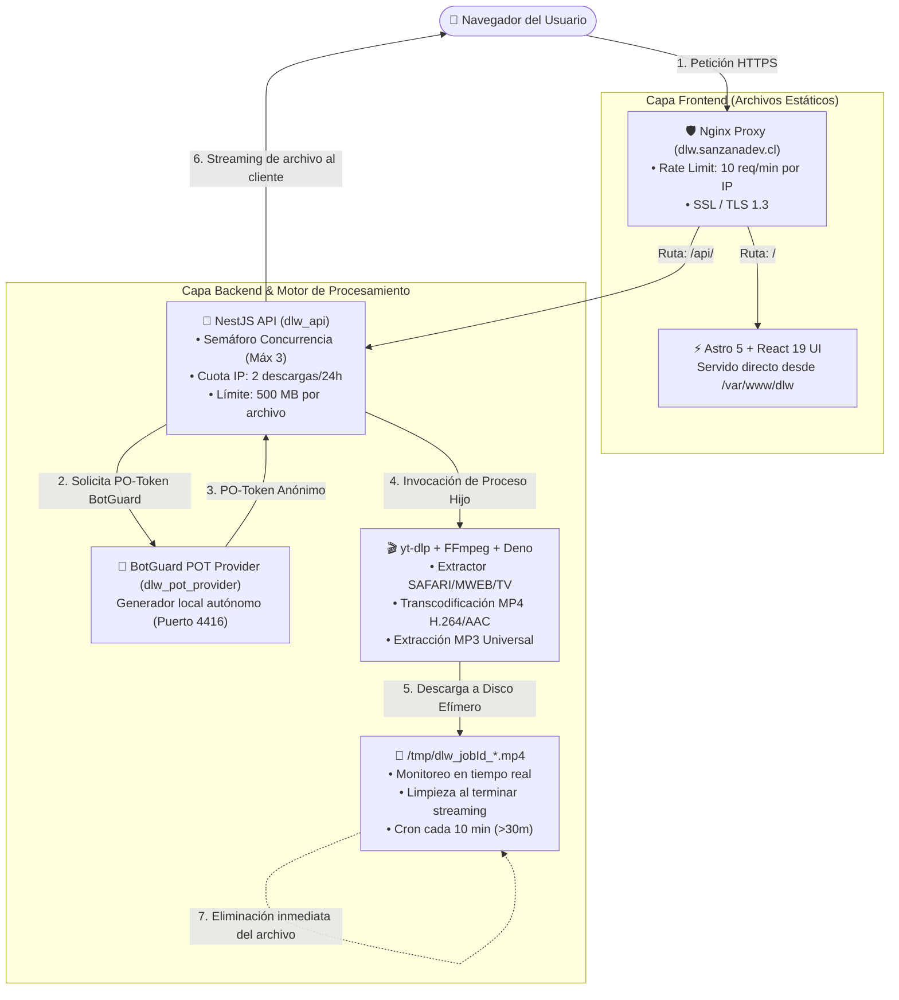
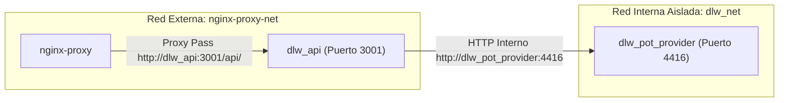

# 📥 Descarga la Weá (DLW) - Plataforma Universal de Descarga de Medios

Plataforma web moderna, ligera y de alto rendimiento diseñada para la extracción, transcodificación y descarga universal de video y audio desde múltiples plataformas (YouTube, TikTok, Instagram, entre otras). 

Construida bajo el principio **KISS (Keep It Simple, Stupid)**, prescinde de bases de datos pesadas o sistemas de colas externos (como Redis/BullMQ), implementando en su lugar un motor reactivo en memoria con persistencia ligera en disco, control estricto de concurrencia, protección perimetral y administración inteligente de cuotas de ancho de banda.

---

## 🏗️ 1. Arquitectura del Sistema

El sistema opera en una arquitectura desacoplada de alto rendimiento donde el frontend se distribuye como archivos estáticos compilados y el backend coordina la extracción mediante un motor especializado de `yt-dlp` asistido por un generador autónomo de tokens anti-bot.

### Flujo de Datos y Solicitudes



### Topología de Redes en Producción (Docker)



---

## 🛠️ 2. Stack Tecnológico

| Área | Tecnología | Versión | Rol / Propósito |
| :--- | :--- | :--- | :--- |
| **Frontend** | [Astro](https://astro.build/) | `v5.x` | Generación de sitio estático (SSG), arquitectura de islas y rendimiento Core Web Vitals ultra rápido. |
| **Componentes UI** | [React](https://react.dev/) | `v19.x` | Interfaz interactiva de búsqueda, barra de progreso reactiva, visualización de cuota y selector de calidades. |
| **Estilos** | [Tailwind CSS](https://tailwindcss.com/) | `v4.x` | Diseño cyberpunk/minimalista responsivo optimizado para móviles y escritorio. |
| **Backend** | [NestJS](https://nestjs.com/) | `v11.x` | API modular en TypeScript, validación de cuotas, semáforos de concurrencia y streaming de archivos. |
| **Motor Multimedia** | [yt-dlp](https://github.com/yt-dlp/yt-dlp) | *Última estable* | Extracción de flujos de video/audio, descarga multi-hilo y soporte para cientos de plataformas. |
| **Transcodificador** | [FFmpeg](https://ffmpeg.org/) | `v6.x / v7.x` | Multiplexación a MP4 universal (H.264 + AAC + `faststart` para WhatsApp e iOS) y extracción a MP3 de alta fidelidad. |
| **JavaScript Engine** | [Deno](https://deno.com/) | *Última estable* | Motor de ejecución JavaScript dentro del contenedor para resolver retos de extracción e intercepciones dinámicas de YouTube. |
| **Anti-Bot Bypass** | `bgutil-ytdlp-pot-provider` | *Latest* | Proveedor local de tokens Proof-of-Origin (PO-Tokens) de BotGuard sin requerir cuentas de Google ni IPs residenciales. |
| **Reverse Proxy** | [Nginx](https://nginx.org/) | `Alpine` | Terminación SSL (TLS 1.2/1.3), compresión gzip, caché de assets y rate-limiting perimetral anti-DoS. |
| **Certificados** | [Certbot](https://certbot.eff.org/) | *Latest* | Renovación automática de certificados SSL Let's Encrypt mediante desafíos HTTP-01. |

---

## 🛡️ 3. Sistema de Seguridad y Control de Cuota

La plataforma cuenta con un sistema de defensa multicapa para proteger la integridad del VPS y garantizar que los recursos mensuales (ancho de banda y CPU) no sean agotados:

```
[Usuario / Atacante]
         │
         ▼
┌────────────────────────────────────────────────────────┐
│ Capa 1: Nginx Proxy (Rate Limit: 10 req/min por IP)     │ ──> Bloquea ráfagas en memoria con HTTP 429
└────────────────────────────────────────────────────────┘
         │
         ▼
┌────────────────────────────────────────────────────────┐
│ Capa 2: Detección de IP Real (Cloudflare / X-Forwarded) │ ──> app.set('trust proxy', true)
└────────────────────────────────────────────────────────┘
         │
         ▼
┌────────────────────────────────────────────────────────┐
│ Capa 3: Cuota de Descargas Diarias (2 videos / 24h)    │ ──> Ventana móvil de 24 horas por IP
└────────────────────────────────────────────────────────┘
         │
         ▼
┌────────────────────────────────────────────────────────┐
│ Capa 4: Filtro de Duración y Límite de Tamaño          │ ──> Rechaza directos, videos >2h y >500 MB
└────────────────────────────────────────────────────────┘
         │
         ▼
┌────────────────────────────────────────────────────────┐
│ Capa 5: Semáforo de Concurrencia (Máx. 3 en paralelo)   │ ──> Evita saturación de CPU y RAM
└────────────────────────────────────────────────────────┘
         │
         ▼
┌────────────────────────────────────────────────────────┐
│ Capa 6: Cuotas de Hardware Docker (1.5 CPU / 1GB RAM)  │ ──> Protege otros servicios del VPS (ej: misgastos)
└────────────────────────────────────────────────────────┘
```

1. **Protección Perimetral Nginx**:
   - Zona de memoria: `limit_req_zone $binary_remote_addr zone=dlw_api_limit:10m rate=10r/m;`.
   - Limita a 10 solicitudes por minuto por IP con ráfaga de 5 (`burst=5 nodelay`).
2. **Cuota Diaria por IP**:
   - Cada IP puede realizar un máximo de **2 descargas por período móvil de 24 horas** (`MAX_DOWNLOADS_PER_IP_DAY=2`).
   - El estado se persiste automáticamente en `/tmp/dlw_ip_quotas.json` para que reiniciar o actualizar contenedores no borre las cuotas asignadas.
   - **Reembolso automático**: Si una descarga falla por un problema de origen, la cuota de la IP se devuelve inmediatamente.
3. **Límite de Tamaño Máximo de Archivo**:
   - Tope de **500 MB** (`MAX_DOWNLOAD_SIZE_MB=500`).
   - Se inyecta `--max-filesize 500M` a `yt-dlp`.
   - Los formatos que excedan 500 MB se descartan de la lista de metadatos antes de que el usuario los seleccione.
   - El frontend desactiva visualmente las opciones pesadas (`⚠️ Excede límite máx. de 500 MB`).
   - Si durante la descarga el archivo en disco supera los 500 MB, el proceso se aborta de inmediato.
4. **Semáforo de Concurrencia**:
   - Máximo **3 descargas simultáneas globales** en el servidor. Solicitudes adicionales reciben `HTTP 429`.
5. **Filtro de Contenido**:
   - Duración máxima permitida: **2 horas (7,200 segundos)**.
   - Bloqueo estricto de transmisiones en vivo (`raw.is_live`).
6. **Manejo Seguro de Almacenamiento Efímero**:
   - Los archivos en `/tmp` se transmiten en streaming y se destruyen en el evento `finish` o `close` de la conexión HTTP.
   - Un cron en segundo plano (`cleanupOldJobs`) purga archivos temporales cada 10 minutos si superan los 30 minutos de antigüedad.
7. **Aislamiento de Cookies**:
   - Si se montan cookies de YouTube en modo solo lectura (`:ro`), el backend copia el archivo a `/tmp/yt-dlp-cookies.txt` con permisos de escritura, evitando fallos de `OSError: [Errno 30] Read-only file system` causados por `yt-dlp` al intentar actualizar tokens de sesión.

---

## 🐳 4. Contenedores y Servicios Docker

### Matriz de Contenedores

| Servicio | Nombre del Contenedor | Imagen Base | Redes | Puertos Expuestos | Volúmenes |
| :--- | :--- | :--- | :--- | :--- | :--- |
| **POT Provider** | `dlw_pot_provider` | `brainicism/bgutil-ytdlp-pot-provider:latest` | `dlw_net` | `4416` (Solo interno) | Ninguno |
| **Backend API** | `dlw_api` | Construida local (`./backend-dlw/Dockerfile`) | `dlw_net`, `nginx-proxy-net` | `3001` (Interno en Docker) | `./cookies:/app/cookies:ro` |
| **Reverse Proxy** | `nginx-proxy` | `nginx:alpine` | `nginx-proxy-net` | `80:80`, `443:443` (Públicos) | `./conf.d:/etc/nginx/conf.d:ro`<br/>`../descarga-la-wea/frontend-dlw/dist:/var/www/dlw:ro`<br/>`./certbot/conf:/etc/letsencrypt:ro`<br/>`./certbot/www:/var/www/certbot:ro` |
| **Certbot** | `certbot` | `certbot/certbot:latest` | Ninguna | Ninguno | `./certbot/conf:/etc/letsencrypt`<br/>`./certbot/www:/var/www/certbot` |

### Variables de Entorno

| Variable | Valor por Defecto | Descripción |
| :--- | :--- | :--- |
| `PORT` | `3001` | Puerto en el que escucha la API de NestJS. |
| `NODE_ENV` | `production` / `development` | Entorno de ejecución de Node.js. |
| `POT_PROVIDER_URL` | `http://dlw_pot_provider:4416` | URL interna hacia el generador de PO-Tokens de BotGuard. |
| `COOKIES_PATH` | `/app/cookies/cookies.txt` | Ruta al archivo de cookies opcional de sesión para YouTube. |
| `PROXY_URL` | *(Vacío)* | Proxy opcional HTTP/SOCKS5 para enrutar el tráfico de `yt-dlp`. |
| `MAX_DOWNLOADS_PER_IP_DAY` | `2` | Número máximo de descargas permitidas por IP en 24 horas. |
| `MAX_DOWNLOAD_SIZE_MB` | `500` | Tamaño máximo en Megabytes permitido por archivo descargado. |
| `PUBLIC_API_URL` | `/api` (prod) / `http://localhost:3001/api` (dev) | URL base para las llamadas fetch desde el frontend. |

---

## 🚀 5. Guía de Ejecución: Desarrollo Local

### Opción A: Levantar con Docker Compose (Recomendado)

Esta opción recrea el entorno idéntico a producción (con recarga en vivo de código mediante volúmenes montados):

```bash
# 1. Clonar el repositorio y entrar en la carpeta
cd descarga-la-wea

# 2. Levantar los tres contenedores de desarrollo (Frontend, Backend y POT Provider)
docker compose -f docker-compose.dev.yml up --build
```

- **Frontend (Astro dev)**: `http://localhost:4321`
- **Backend API**: `http://localhost:3001/api`
- **POT Provider**: `http://localhost:4416`

Para detener los servicios:
```bash
docker compose -f docker-compose.dev.yml down
```

---

### Opción B: Levantar en Bare Metal (Sin Docker local)

Si prefieres ejecutar directamente en tu máquina con Node.js:

#### Prerrequisitos en tu sistema operativo:
- **Node.js** >= `22.x` y **npm**
- **Python 3** y `pip install yt-dlp`
- **FFmpeg** instalado y accesible en tu `$PATH`
- **Deno** instalado (`curl -fsSL https://deno.land/install.sh | sh`)

#### Terminal 1: Backend
```bash
cd backend-dlw
npm install
npm run start:dev
```
*El backend escuchará en `http://localhost:3001/api`.*

#### Terminal 2: Frontend
```bash
cd frontend-dlw
npm install
npm run dev
```
*El frontend estará disponible en `http://localhost:4321`.*

#### Ejecutar Pruebas Unitarias del Backend
```bash
cd backend-dlw
npm test
```

---

## 🌐 6. Guía de Despliegue: Producción en VPS

Esta guía describe cómo desplegar **Descarga la Weá** en tu VPS (ej. Vultr con Ubuntu/Debian) integrándolo con el contenedor central `nginx-proxy` existente bajo el dominio `dlw.sanzanadev.cl`.

### Topología de Carpetas Recomendada en el VPS

```text
/home/usuario/
├── nginx-proxy/                 # Contenedor central Nginx del VPS
│   ├── docker-compose.yml
│   ├── conf.d/
│   │   ├── dlw.conf             # Archivo de configuración copiado
│   │   └── misgastos.conf
│   └── certbot/
│       ├── conf/                # Almacena /etc/letsencrypt
│       └── www/                 # Almacena desafíos /.well-known/acme-challenge/
└── app-dlw/                     # Repositorio clonado
    ├── docker-compose.prod.yml
    ├── nginx/
    │   └── dlw.conf
    ├── cookies/
    │   └── cookies.txt          # (Opcional) Cookies de sesión
    ├── frontend-dlw/
    │   └── dist/                # Build estático generado
    └── backend-dlw/
```

---

### Paso 1: Asegurar la Red Externa Compartida

Comprueba que la red de Docker para el proxy inverso exista:

```bash
docker network create nginx-proxy-net 2>/dev/null || true
```

---

### Paso 2: Configurar Volúmenes en el `docker-compose.yml` de `nginx-proxy`

En la carpeta de tu `nginx-proxy` en el VPS, asegúrate de que el contenedor de Nginx tenga montada la carpeta del frontend compilado de DLW:

```yaml
services:
  nginx-proxy:
    image: nginx:alpine
    container_name: nginx-proxy
    restart: always
    ports:
      - "80:80"
      - "443:443"
    volumes:
      - ./conf.d:/etc/nginx/conf.d:ro
      - /home/usuario/app-dlw/frontend-dlw/dist:/var/www/dlw:ro   # Frontend estático de DLW
      - ./certbot/conf:/etc/letsencrypt:ro
      - ./certbot/www:/var/www/certbot:ro
    networks:
      - nginx-proxy-net
```

---

### Paso 3: Compilar el Frontend Estático

En la carpeta del proyecto en el VPS:

```bash
cd /home/usuario/app-dlw/frontend-dlw
npm ci
npm run build
```
*Esto generará la carpeta `frontend-dlw/dist/` optimizada con HTML, JS y CSS listos para ser servidos por Nginx.*

---

### Paso 4: Instalar la Configuración de Nginx (Modo HTTP Inicial)

1. Copia el archivo de configuración a la carpeta `conf.d/` de tu `nginx-proxy`:
   ```bash
   cp /home/usuario/app-dlw/nginx/dlw.conf /home/usuario/nginx-proxy/conf.d/dlw.conf
   ```
2. Valida la sintaxis de Nginx y recarga el servicio:
   ```bash
   docker exec nginx-proxy nginx -t
   docker exec nginx-proxy nginx -s reload
   ```

---

### Paso 5: Emitir el Certificado SSL con Certbot

Ejecuta el desafío Webroot a través del contenedor `certbot`:

```bash
docker exec certbot certbot certonly --webroot \
  -w /var/www/certbot \
  -d dlw.sanzanadev.cl \
  --email tu-correo@ejemplo.com \
  --agree-tos \
  --no-eff-email
```

---

### Paso 6: Activar Redirección HTTPS y Puerto 443 en Nginx

1. Edita `/home/usuario/nginx-proxy/conf.d/dlw.conf`:
   - En el bloque `server { listen 80; ... }`, comenta las líneas de servir el frontend y descomenta la redirección a HTTPS:
     ```nginx
     location / {
         return 301 https://$host$request_uri;
     }
     ```
   - Descomenta el bloque completo `server { listen 443 ssl; ... }`.
2. Prueba y aplica los cambios:
   ```bash
   docker exec nginx-proxy nginx -t
   docker exec nginx-proxy nginx -s reload
   ```

---

### Paso 7: Levantar el Backend y el Proveedor POT en Producción

En la carpeta de la aplicación (`app-dlw`):

```bash
cd /home/usuario/app-dlw

# Levantar dlw_api y dlw_pot_provider en segundo plano
docker compose -f docker-compose.prod.yml up -d --build
```

Verificar que los contenedores estén corriendo y conectados:
```bash
docker compose -f docker-compose.prod.yml ps
```

---

## 📡 7. Referencia de la API REST

Todos los endpoints del backend se encuentran prefijados por `/api`.

### 1. Consultar Cuota Disponible por IP
- **Método**: `GET /api/downloads/quota`
- **Descripción**: Informa cuántas descargas le quedan a la IP en las últimas 24 horas y el límite de tamaño.
- **Respuesta (JSON)**:
  ```json
  {
    "ip": "190.160.10.25",
    "allowed": true,
    "used": 1,
    "remaining": 1,
    "maxPerDay": 2,
    "maxDownloadSizeMb": 500,
    "resetInSeconds": 43200,
    "resetInHours": 12
  }
  ```

---

### 2. Obtener Información y Formatos de Video
- **Método**: `POST /api/downloads/info`
- **Body (JSON)**:
  ```json
  {
    "url": "https://www.youtube.com/watch?v=dQw4w9WgXcQ"
  }
  ```
- **Respuesta**:
  Devuelve título, miniatura, duración en segundos, canal/uploader y un arreglo clasificado de opciones:
  - `video_audio`: Combinaciones garantizadas con imagen y sonido.
  - `video_only`: Pistas de video puro (mudo).
  - `audio_only`: Preset MP3 de alta fidelidad y flujos de audio nativos.
  *(Formatos mayores a 500 MB son filtrados automáticamente).*

---

### 3. Iniciar Tarea de Descarga en Segundo Plano
- **Método**: `POST /api/downloads/start`
- **Body (JSON)**:
  ```json
  {
    "url": "https://www.youtube.com/watch?v=dQw4w9WgXcQ",
    "formatSelection": "137+140",
    "type": "video_audio",
    "title": "Rick_Astley_Never_Gonna_Give_You_Up"
  }
  ```
- **Respuesta**:
  ```json
  {
    "jobId": "e5b6c31e-4509-482a-bc9d-1fb263914a8f"
  }
  ```
- **Errores Posibles**:
  - `429 Too Many Requests`: Si la IP superó las 2 descargas en 24h (`"Has alcanzado el límite de descargas diario."`) o si hay más de 3 descargas simultáneas en curso.
  - `400 Bad Request`: Si la URL es inválida, si es un directo o si excede las 2 horas.

---

### 4. Consultar Progreso de la Tarea
- **Método**: `GET /api/downloads/:jobId/status`
- **Respuesta (En Progreso)**:
  ```json
  {
    "id": "e5b6c31e-4509-482a-bc9d-1fb263914a8f",
    "status": "downloading",
    "progressPercent": 48.5,
    "downloadSpeed": "12.4MiB/s",
    "eta": "00:04",
    "totalBytes": "85.20MiB",
    "title": "Rick_Astley",
    "ext": "mp4"
  }
  ```
- **Respuesta (Completado)**:
  ```json
  {
    "id": "e5b6c31e-4509-482a-bc9d-1fb263914a8f",
    "status": "completed",
    "progressPercent": 100,
    "title": "Rick_Astley",
    "ext": "mp4"
  }
  ```

---

### 5. Descargar Archivo Terminado
- **Método**: `GET /api/downloads/:jobId/file`
- **Descripción**: Inicia el streaming binario del archivo generado (`audio/mpeg` o `video/mp4`) con cabecera `Content-Disposition: attachment`.
- **Efecto Secundario**: Una vez finalizada la transmisión o si el cliente desconecta, el archivo temporal en el disco del VPS se elimina de forma automática.

---

## 🔧 8. Monitoreo, Mantenimiento y Diagnóstico

### Ver Logs en Tiempo Real

```bash
# Logs del backend de descargas
docker logs -f dlw_api

# Logs del generador de tokens de BotGuard
docker logs -f dlw_pot_provider

# Logs de Nginx Proxy
docker logs -f nginx-proxy
```

### Inspeccionar o Limpiar Cuotas de IP Manualmente

Las cuotas activas por IP se almacenan dentro del contenedor de la API en `/tmp/dlw_ip_quotas.json`:

```bash
# Leer las IPs y marcas de tiempo registradas
docker exec dlw_api cat /tmp/dlw_ip_quotas.json

# Resetear todas las cuotas de IP manualmente si es necesario
docker exec dlw_api rm -f /tmp/dlw_ip_quotas.json
```

### Probar Extracción de Video Dentro del Contenedor

Para verificar que `yt-dlp` y el proveedor de PO-Tokens estén funcionando sin problemas con YouTube:

```bash
docker exec -it dlw_api yt-dlp \
  --extractor-args "youtubepot-bgutilhttp:base_url=http://dlw_pot_provider:4416" \
  --dump-json "https://www.youtube.com/watch?v=dQw4w9WgXcQ"
```

### Actualizar la Imagen de yt-dlp y Dependencias

```bash
cd /home/usuario/app-dlw
docker compose -f docker-compose.prod.yml build --no-cache
docker compose -f docker-compose.prod.yml up -d
```

---

## 📄 Licencia

Este proyecto está distribuido bajo la licencia MIT. Uso personal y educativo.
